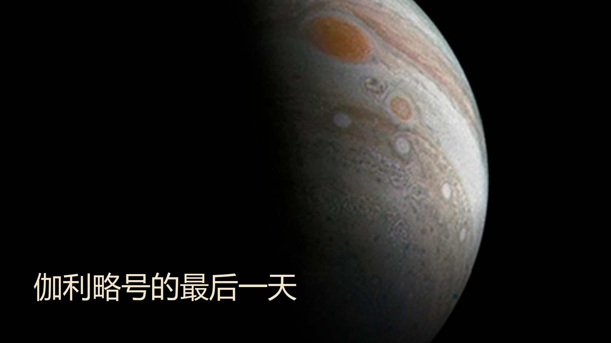
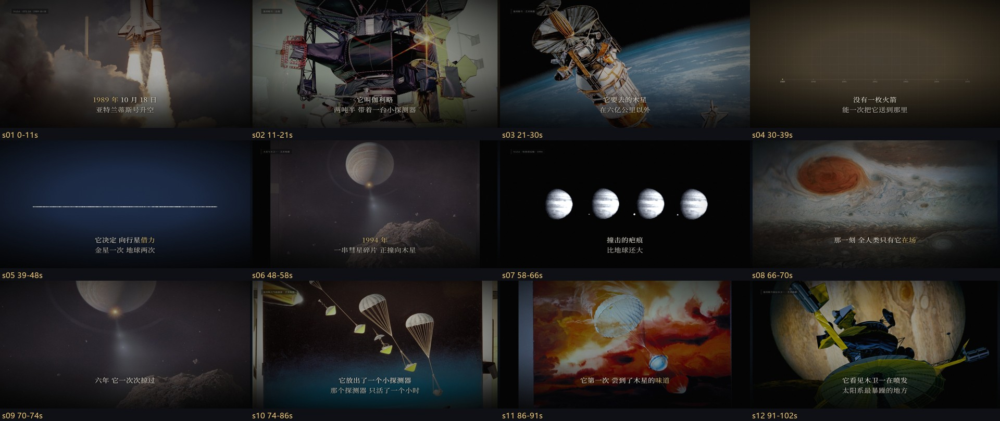

# Documentary Engine · 用代码做纪录片

一套把「写剧本」变成「出成片」的引擎。输入一份 EDL（分镜数据）或一份 30 行的剧本，
输出 1080p 成片、SRT 字幕、封面与元数据。

**核心原则：渲染器不认识故事。** 所有创作决定都在数据里，代码只负责执行。

<p align="center">
  
</p>

---

## 它做出了什么

| 片子 | 镜头 | 时长 | 覆盖率 | 亮度 | 渲染 |
|---|---|---|---|---|---|
| 《单程票》旅行者号 | 24 | 180s | 0.290 | 36.4 | 39 分钟 |
| 《伽利略号的最后一天》 | 23 | 180s | 0.400 | 31.1 | 53 分钟 |
| 《伽利略号》草案版（30 行剧本生成） | 21 | 180s | 0.390 | 40.1 | 26 分钟 |

参考片基线（同为 2 倍速高亮度素材，不必追平）：frame_diff 2.29 / moving 0.774 / coverage 0.381 / luma 31.7。

<p align="center">
  
</p>

---

## 三步

```bash
# 1. 写剧本（30 行），生成分镜草案
python film.py draft scripts/galileo.script.json --duration 180

# 2. 校验 + 渲前质检（<1 分钟）
python film.py check   examples/galileo-draft.json
python film.py preview examples/galileo-draft.json

# 3. 渲到成片（增量 + 并行）
python film.py all     examples/galileo-draft.json
```

`all` 的完整链路：

```
lint → style → preview → build → render(增量+并行) → score → encode
                                                          ↓
                                              deliver(SRT/封面/元数据) → video-qc → compare
```

---

## 四种用法

### A. 剧本 → 草案（最快）

一个 beat 只有四个字段：

```json
{ "id": "a1", "title": "出发", "mood": "amber",
  "beats": [
    { "text": "1989 年 10 月 18 日\n亚特兰蒂斯号升空",
      "asset": "launch", "caption": "NASA · STS-34" },
    { "text": "没有一枚火箭\n能一次把它送到那里",
      "graphics": "timeline" } ]}
```

引擎自动算时长（字数/4.2 + 入出）、做节奏塑形（单行句 ×0.62 快切、带出处长句 ×1.18）、
归一总长、交替推拉方向、暗素材自动提亮、数字自动染金、末镜自动落版。

详见 `director/DRAFT.md`。

### B. 镜头库装配

```python
from director.film import Film
from director import shots as S

f = Film({...})
f.add(S.archive("s01", "a1", 0, 8, "europa", "jade",
                caption="NASA · 欧罗巴", lines=["木星旁边 有一颗月亮"]))
f.add(S.ending("s02", "a2", 8, 8, lines=["我们还没有到过那里"]))
f.finalize().save("examples/新片.json")
```

### C. 直接写 EDL

照 `examples/galileo.json` 改。规范见 `schemas/edl.schema.json`。

### D. 主控命令

```bash
python film.py new      <路径>       建骨架
python film.py draft    <剧本>       剧本 → 草案
python film.py check    <edl>        结构 + 风格（<2 秒）
python film.py preview  <edl>        渲前质检（30 秒）
python film.py render   <edl>        只渲
python film.py all      <edl>        一路到成片
python film.py deliver  <edl> <成片>  字幕/封面/元数据
python film.py video    <edl> <成片>  视频级质检
python film.py selftest             质检器自检（9 项）
```

---

## 模块

```
film.py               主控 CLI
director/             编排层（改片子只动这里）
  film.py             Film：EDL 读写 / 时间轴
  shots.py            镜头库：archive / hold / graphics_shot / montage / ending
  draft.py            剧本 → 分镜草案
  assets.py           素材登记表
render/engine/        渲染器（只认 EDL）
  render.html + 9 个 JS 模块 + CSS
qc/                   质检五件套 + 自检
  lint.py             结构规则
  preview.py          渲前静帧排版
  style.py            色彩与亮度
  video.py            视频级（闪烁/卡顿/抖动/黑场/节奏/音频）
  compare.py          四项指标
  selftest.py         质检器单元测试
io/                   输入输出
  build.py capture.py render.py plan.py encode.py score.py deliver.py
```

---

## 引擎能力

| 能力 | 说明 |
|---|---|
| **六层字幕** | T1 叙事 / T2 引语 / T3 数据 / T4 角落 / T5 出处 / T6 刻度，累积生长 + 关键词染金 |
| **图形摄像机** | 推拉、平移、非等比拉伸（×1.32/1.22）、按深度视差、`overlay` 层不参与变形 |
| **21 种程序图形** | 网格/轴、线/光、数据（柱状/散点/波束叠加）、粒子/空间、信号 |
| **调色系统** | 五种 mood（amber/steel/jade/deep/neutral），只作用素材不污字幕 |
| **增量渲染** | 镜头级哈希，改一个镜头只重渲那段（13×） |
| **并行渲染** | 多浏览器分段（2 实例 3.7×） |
| **量化质检** | 五层 + 自检，0 误报 |
| **交付物** | SRT / 封面 / 章节 / 素材授权清单 |

---

## 实测数据

### 增量 + 并行（40 秒 demo，1200 帧）

| 模式 | 耗时 |
|---|---|
| 串行 | 1429s |
| 并行 2 实例 | **381s** |
| 改 1/6 镜头 + 2 实例 | **110s** |

### 质检误报校准

第一版视频质检报 34 条问题，**全是误报**：抽帧分辨率过低把慢推拉压平、
镜头边界帧差被算进新镜头、波束图形被当成字幕。校准后 **0 误报**。

---

## 已知限制

| 限制 | 说明 |
|---|---|
| 渲染 | 0.3–1.2 秒/帧，3 分钟片 24–53 分钟 |
| 图形 | 21 个 kind，无真三维 |
| 素材 | 只有 NASA API 内置 |
| 音频 | 只能裁切 + 包络，不能生成原创配乐 |
| 剧本 | 仍要人写，不做"从选题全自动" |
| 平台 | 路径目前写死 Windows（FFmpeg / Edge 绝对路径） |

---

## 素材与授权

- 影像：NASA Image and Video Library（公有领域）
- 配乐：[Eternal Hope — Kevin MacLeod](https://incompetech.com/music/royalty-free/index.html)，CC BY 4.0
- 本仓库代码：MIT

配乐文件不入库（CC-BY 允许转载但体积大）。运行时把曲目放到 `assets/music/` 即可；
不配乐也能跑，`score` 环节会自动跳过。

---

## 快速开始

```bash
git clone <this-repo>
cd documentary-engine
pip install opencv-python numpy pillow websocket-client
# 需要 Windows + Microsoft Edge（headless）+ ffmpeg

python film.py selftest                                   # 质检器自检
python film.py draft scripts/galileo.script.json --duration 180
python film.py preview examples/galileo-draft.json
python film.py all     examples/galileo-draft.json        # 约 26 分钟
```

---

## 参考

- `reference/图形语言.md` —— 对参考片 82–101 秒的逐帧实测（推进 1.7×、五层 alpha、六个动画轨道）
- `reference/thresholds.json` —— 质检阈值与参考片基线
- `director/DRAFT.md` —— 剧本格式与生成规则
- `qc/VIDEO.md` —— 视频级质检的判据与校准过程

---

*独立项目，与 NASA / JPL 无关。片中部分画面为 NASA 艺术构想图，非实拍。*
