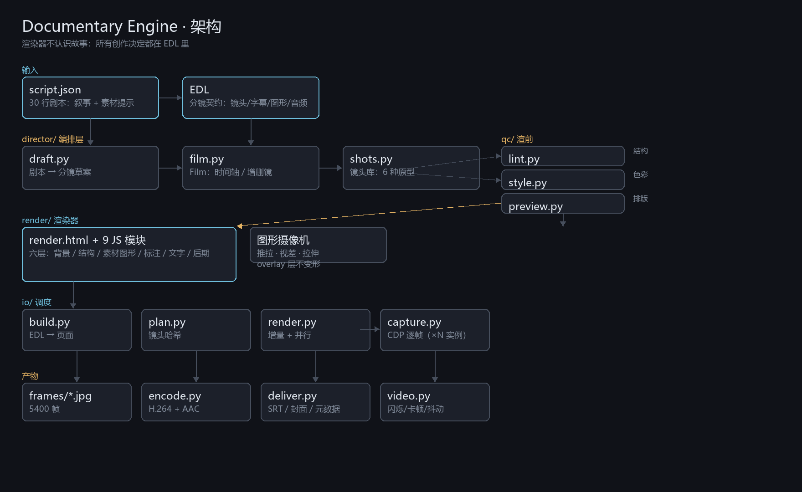

# 拆解 AI 代码动画：原理与重建

> 对参考片《1859–2026》的逐帧逆向分析，以及在重建引擎上的对照测量。

---

## 0. 结论先行

一部 234 秒的 AI 代码动画，逐帧测量后可以确认：**它不是"一键生成"，也不是"剪辑软件做出来的"。**

它是一份**分镜数据表**，交给一个**只认数据、不认识故事**的渲染器，逐帧用纯函数算出来的。

帧 i 的画面只由 `t = i / fps` 决定。因此：可复现、可局部重渲、可量化质检。

下面的数据来自对该片的逐帧测量（234s @2x，320×180 统一到同一算法），以及我自己重建后的对照。

---

## 1. 参考片实测

| 指标 | 参考片 | 我重建的片 |
|---|---|---|
| frame_diff（相邻帧平均差） | **2.29** | 1.78 |
| moving（有运动帧占比） | **0.774** | 1.00 |
| coverage（非黑细节占比） | **0.381** | 0.390 |
| luma（平均亮度 0–255） | **31.7** | 31.1 |

结构：

| 项 | 数值 |
|---|---|
| 镜头数 | 52 |
| 中位镜长 | 3.6 s |
| 最长无硬切段 | **47.8 s**（53.5–101.2s） |
| 最长无字幕段 | **32 s**（168–200s） |
| 字幕层级 | 6 层 |
| 金色关键词出现率 | 45% 的字幕帧 |
| SFX | 0 |
| 节拍对齐 | 无（cut-onset 相关性仅比随机高 20%） |

---

## 2. 三条可复用的实现原理

### 2.1 推的是「图形空间」，不是素材

84–92 秒，摄像机推近 1.7 倍。逐段测量：

| 时间段 | 坐标轴跨度 | 放大 |
|---|---|---|
| 84.0–86.5s | 316 → 442 px | **+40% / 2.5s** |
| 87.0–92.5s | 572 → 696 px | **+22% / 4.5s** |

网格、坐标轴、波线、光点**等比一起放大**。

这和"放大一张图片"是两套机制：前者需要摄像机作用于整个图形层，后者只是 asset transform。

实现上必须把图形先画到离屏缓冲，再按摄像机矩阵合成，否则各图元会各自动作、无法一致。

### 2.2 五层 alpha

同一帧内叠加的层级与不透明度：

| 层 | alpha |
|---|---|
| 径向背景辉光 | 0.10 |
| 网格 | **0.05** |
| 波线 | **0.30** |
| 坐标轴 / 刻度 | 0.60 |
| 光点 | 1.00 |

**规律：越远的层越淡。** 这一条决定画面是"一块图"还是"有纵深的场景"。

### 2.3 六条独立动画轨道

| 元素 | 驱动 |
|---|---|
| 摄像机 | 推近 1.7×，8 秒内 |
| 零点光点 | 亮度脉动，相位各自不同 |
| 波线 | 相位流动，每条速度不同 |
| 叠加曲线 | 振幅随波加入而增大 |
| 坐标轴 | 从左伸展 |
| 字幕 | 逐句累积 |

---

## 3. 架构

<p align="center">
  
</p>

```
script.json ──► director/draft.py ──┐
                                    ├──► EDL ──► qc/lint · style · preview
director/film.py + shots.py ────────┘                │
                                                     ▼
                                          io/build.py ──► render/engine
                                                     │        (HTML+JS+CSS)
                                                     ▼
                                          io/render.py ── io/plan.py（镜头哈希）
                                                     │      ×N capture.py 实例
                                                     ▼
                                          frames/*.jpg ──► encode ──► mp4
                                                     │
                                     ┌───────────────┴───────────────┐
                                     ▼                               ▼
                              io/deliver.py                    qc/video.py
                          (SRT/封面/元数据)               (闪烁/卡顿/抖动/黑场)
```

**模块边界：改动只在 `director/` 发生。** 渲染器与质检器是稳定的。

| 模块 | 职责 | 关键文件 |
|---|---|---|
| `director/` | EDL 读写、镜头库、剧本→草案 | film.py / shots.py / draft.py |
| `render/engine/` | 只认 EDL 的渲染器 | render.html + 9 JS + CSS |
| `qc/` | 五层质检 + 自检 | lint / preview / style / video / compare / selftest |
| `io/` | 构建、渲染调度、编码、配乐、交付 | build / plan / render / capture / encode / score / deliver |

---

## 4. 实现要点

### 渲染分层

```
#stage
 ├─ #world          ← 调色滤镜只作用这一层
 │   ├─ #asset-wrap > img     素材 + 肯伯恩斯 + 透视
 │   ├─ #graphics            图形主画布
 │   │    └─ 3 块离屏缓冲     按 depth 分层，摄像机分别变换
 │   └─ #grade
 ├─ #texts          ← 六层字幕，不受调色影响
 ├─ #vignette
 └─ #grain
```

排版用 DOM（中文混排、字距、渐变优于 canvas `measureText`），图形用 Canvas（粒子/波线需要逐帧重绘 + bloom）。

### 图形摄像机参数

```json
"camera": { "s0": 1.0, "s1": 1.26,
            "sx0": 1.0, "sx1": 1.32, "sy0": 1.0, "sy1": 1.22,
            "t0": 0.2, "t1": 4.8, "ease": "easeInOut",
            "cy": 0.44, "parallax": 0.6 }
```

- `sx ≠ sy` → 非等比拉伸（参考片推近时有轻微横向拉宽）
- `parallax` → 按 `graphics[].depth` 分层视差
- `overlay: true` → 不参与变换（坐标轴、数字），避免文字被拉变形

### 累积式字幕必须预留排版位

第一版是底部锚定 + 动态追加，实测第二行出现时整块文字**上跳 85px**。

修法：所有 text 块预先渲染、未到的用 `visibility:hidden` 占位；T1 组统一预留两行高度。

修后四个采样点全部从 y=817 起：

```
t=2.4s  817–866      t=44s  817–866
t=6.0s  817–950      t=90s  817–866
```

---

## 5. 工程化：三个可量的改进

### 5.1 增量渲染（13×）

渲染是纯函数，所以"改了哪些镜头" = "要重渲哪些帧"。

用镜头级哈希（只覆盖影响画面的字段：asset / motion / optics / grade / brightness / camera / texts / graphics + moods + 分辨率）：

| 场景 | 耗时 |
|---|---|
| 40 秒片全量 | 1429 s |
| 改 1/6 镜头 | **110 s** |

改字幕触发重渲，改标题不触发。

### 5.2 并行渲染（3.7×）

| 模式 | 40s / 1200 帧 |
|---|---|
| 串行 | 1429 s |
| 并行 2 实例 | **381 s** |
| 并行 3 实例 | 无提升 |

瓶颈是 CSS filter 的软件合成。i5-1135G7 4 物理核，2 个浏览器实例吃满。

### 5.3 质检误报校准

第一版视频质检报 34 条问题，**全是误报**：

| 误报 | 真因 | 修法 |
|---|---|---|
| 132 帧"卡顿" | 抽帧 480p，0.04 的慢推拉被压平 | 抽帧提到 960p |
| 每镜都有"意外硬切" | 镜头边界帧差被算进新镜 | 每镜跳过前 3 帧 |
| 字幕"抖动" 158px | 波束图形在底部有亮块，被当成文字 | 有 graphics 的镜头跳过抖动检测 |

校准后 **0 误报**。

同时补了 `qc/selftest.py`：9 个合成用例，双向断言（该抓的抓到、不该报的不报）。

---

## 6. 现状与限制

| 项 | 状态 |
|---|---|
| 帧差 | 1.78 vs 参考 2.29 —— 参考片有 0.2s 级闪帧，我最快 0.8s |
| 覆盖率 | 0.390 vs 0.381（已追平） |
| 亮度 | 31.1 vs 31.7（已追平） |
| 配乐 | 只能裁切现成曲目 + 响度包络，不能生成原创 |
| 素材源 | 只接了 NASA API |
| 平台 | 路径写死 Windows |
| 质检边界 | 能报"会不会闪/卡"，报不了"这段无聊不无聊" |
| 真三维 | 21 种图形均为 2D 投影近似 |

---

## 7. 仓库

**https://github.com/Shang-en-yee/documentary-engine**

- 完整成片、20 秒高光、SRT、封面、元数据：Release `v0.1.0`
- 代码 MIT，影像 NASA 公有领域，配乐 CC BY 4.0

```
git clone https://github.com/Shang-en-yee/documentary-engine
pip install opencv-python numpy pillow websocket-client
python film.py selftest          # 9/9
python film.py preview examples/galileo-draft.json
```

---

## 附：数据获取方式

所有数值来自同一套脚本，可复现：

```bash
python qc/compare.py examples/x.json out/frames_x    # 四项指标（测源帧，不测编码后视频）
python qc/video.py   examples/x.json out/x-final.mp4 # 时间维度
```

**注意：必须测源帧。** 同一段画面 mp4v 编码后 frame_diff 2.1，H.264 后 1.5 —— 编码器会重写像素差。
